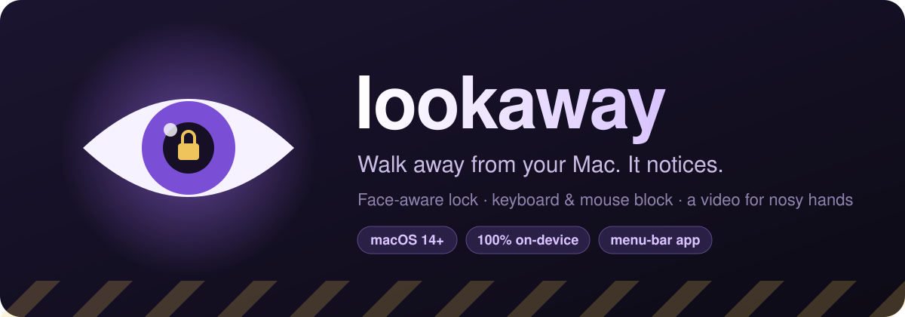
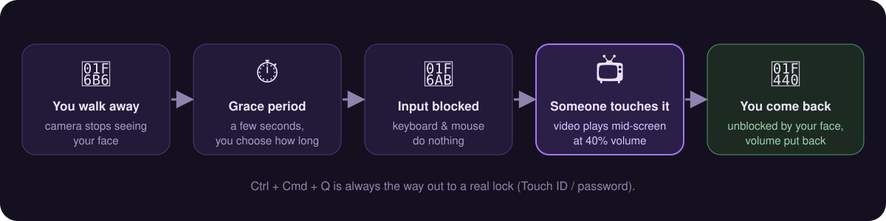
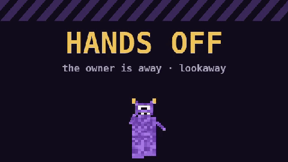
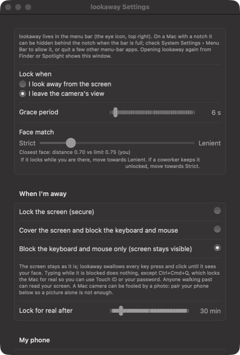

<p align="center">
  
</p>

<p align="center">
  <a href="https://github.com/estatheo/lookaway/releases/latest/download/lookaway.zip"><b>⬇️ Download lookaway</b></a>
  &nbsp;·&nbsp;
  <a href="#-set-it-up-in-5-minutes">Setup guide</a>
  &nbsp;·&nbsp;
  <a href="#-make-it-yours">Use your own video</a>
  &nbsp;·&nbsp;
  <a href="docs/DETAILS.md">All the details</a>
</p>

---

**lookaway** is a tiny menu-bar app for macOS. It uses your Mac's camera to see whether
*you* are sitting in front of it. When you walk away, it blocks the keyboard and mouse.
If anyone then pokes at your Mac, a video pops up in the middle of the screen and plays
at 40% volume 📺. When you sit back down, it recognises your face, unblocks everything,
and puts your volume back exactly how it was.

Everything runs on your Mac. No account, no internet, no photos are saved.

<p align="center">
  
</p>

<table>
<tr>
<td width="50%" valign="top">

### 📺 What a nosy coworker sees

Out of the box lookaway plays its own little **HANDS OFF** clip, with a sad-trombone sound.
You can swap in [any video you like](#-make-it-yours).

</td>
<td width="50%">

</td>
</tr>
</table>

---

## 🚀 Set it up in 5 minutes

> **You need:** a Mac with a camera, on **macOS 14 (Sonoma) or newer**. Apple silicon or Intel both work.

### Step 1 · Download it

<a href="https://github.com/estatheo/lookaway/releases/latest/download/lookaway.zip"></a>

Double-click `lookaway.zip` in your Downloads folder to unzip it. Then drag
**lookaway.app** into your **Applications** folder.

### Step 2 · Open it the first time

lookaway isn't from the App Store, so macOS is careful the first time you open it.

1. Double-click **lookaway** in Applications.
2. If macOS says it *can't be opened* or *can't check it for malicious software*, click
   **Done** (not "Move to Bin").
3. Open  **System Settings → Privacy & Security** and scroll down. Next to
   *"lookaway was blocked…"*, click **Open Anyway** and confirm with your password or
   Touch ID.

<details>
<summary>💡 Prefer the Terminal? One line does the same thing</summary>

```sh
xattr -dr com.apple.quarantine /Applications/lookaway.app && open /Applications/lookaway.app
```

</details>

You only do this once.

### Step 3 · Teach it your face 🙂

The **Enroll my face** window opens by itself, and macOS asks for **Camera** access.
Click **Allow**.

Then follow the prompts for about ten seconds: look at the screen, then slowly turn your
head a little left, right, up and down. **Only you should be in view.**

When it's done, a little 👁 eye appears in your menu bar (top right). That's lookaway.

> Can't see the eye? On a MacBook with a notch, extra menu-bar icons hide behind it.
> Quit a couple of other menu-bar apps, or check **System Settings → Menu Bar**. Opening
> lookaway again from Applications always brings up its Settings window.

### Step 4 · Let it block the keyboard and mouse 🔐

Blocking input needs **Accessibility** permission. Without it, lookaway falls back to
a normal screen lock, and the video never plays.

1. Open  **System Settings → Privacy & Security → Accessibility**.
2. Turn on **lookaway**. If it isn't listed, click **+** and pick it from Applications.

### Step 5 · Check the settings ⚙️

Click the 👁 in the menu bar and choose **Settings…**. A fresh install is already set up
for the video:

<p align="center">
  
</p>

| Setting | What it means | Try |
|---|---|---|
| **Lock when** | *Look away* reacts when you turn your head; *Leave the camera's view* only when you're gone. | *I leave the camera's view* |
| **Grace period** | How long you can be gone before it kicks in. | 5–10 s |
| **Face match** | Locks while you're sitting there? Move it toward **Lenient**. | the middle |
| **When I'm away** | *Block the keyboard and mouse only* is the video mode. | ✅ already selected |
| **Start at login** | Keeps it running after a restart. | on |

### Step 6 · Try it 🎉

Walk out of the camera's view, wait for the grace period, and the 👁 icon turns into a ✋.
Now ask someone to wiggle the mouse. 😈

Sit back down and look at the screen: the ✋ goes away and everything works again.

---

## 🎬 Make it yours

Want a different video? Put any **.mp4**, **.mov** or **.m4v** file here and name it `blocked.mp4`:

```sh
mkdir -p ~/Library/Application\ Support/lookaway
cp ~/Downloads/my-video.mp4 ~/Library/Application\ Support/lookaway/blocked.mp4
```

<details>
<summary>📁 Or do it in Finder</summary>

1. In Finder, press **⇧ ⌘ G** and paste `~/Library/Application Support/`
2. Make a folder called `lookaway` if there isn't one.
3. Drop your video in and rename it to `blocked.mp4`.

</details>

There's nothing to restart: the next touch plays your video. Short clips (3–10 s) are the
funniest, since every new touch after it ends plays it again. To go back to the built-in
clip, delete `blocked.mp4`.

**About the volume:** while the video plays, lookaway unmutes your Mac and sets the volume
to 40%. When the video ends, or when you come back, it puts the volume and mute back exactly
as they were.

---

## 🆘 Help, I'm locked out!

- **You're right there, but it's still blocked?** Look straight at the camera for a second.
  Bad light makes it harder; move **Face match** toward *Lenient* later.
- **The escape hatch:** press **Ctrl + Cmd + Q**. That always swaps the block for a
  normal macOS lock, which you open with Touch ID or your password.
- **It gives up on its own:** after 30 minutes of blocking (you can change this), it turns
  into a normal lock anyway.

> ⚠️ **Be aware:** in video mode your screen stays visible, so anyone walking by can read
> it, and they can't type, but they *can* look. A camera can also be fooled by a photo of
> you. For real security, pick **Lock the screen (secure)** under *When I'm away*, or
> pair your iPhone in Settings so a picture alone isn't enough.

---

## 🛠 Build it yourself

You need Xcode (the full app) installed.

```sh
git clone https://github.com/estatheo/lookaway.git
cd lookaway
scripts/install    # builds, copies to ~/Applications, and opens it
scripts/test       # runs the unit tests
```

`UNIVERSAL=1 scripts/build` makes one app for both Apple silicon and Intel.

How it works under the hood (face matching, attention, the auto-unlock option, phone
proximity, every permission and why) is all in **[docs/DETAILS.md](docs/DETAILS.md)**.

## 🗑 Uninstall

Quit lookaway from its menu, drag **lookaway.app** to the Bin, and delete
`~/Library/Application Support/lookaway`. You can also remove it from
**Privacy & Security → Camera / Accessibility**.

<p align="center"><sub>Made with 👁 and a little mischief · <a href="LICENSE">MIT licence</a></sub></p>
